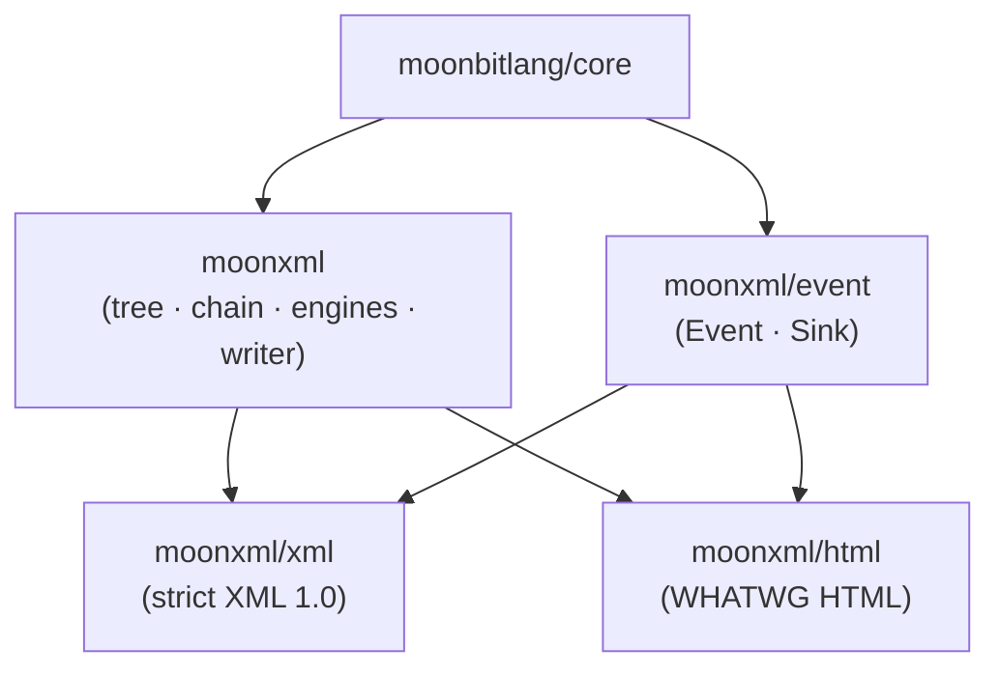

# moonxml — architecture and interface design

> The contract this repository is built to. Interfaces are decided here before
> any implementation exists; a change to this file is a design change, and a
> design change is a discussion, not a commit.
>
> Spelling follows the conversation: standard English (`license`, `color`,
> `serialize`). The task list's en-UK requirement is retired.

## 1. What this is

HTML, XML and SVG for MoonBit: a document goes in, one mutable tree comes out,
queries run against it by CSS selector, XPath or anything a caller registers,
edits happen in place, and the tree writes itself back. Zero I/O, zero
dependencies beyond `moonbitlang/core`; it pairs with moonfetch (fetch a page,
understand a page) without depending on it.

**What was learned from the references** (all studied in `.ref/`):

| Reference | What we take |
|:--|:--|
| lxml.etree | The tree's shape and XPath's semantics; `{uri}local` names |
| lxml.html | One tree, two parsers — the XML parser is strict, the HTML one is not |
| bs4 | The editing verbs (`append`, `unwrap`, `wrap`, `extract`→`remove`, `clear`, `smooth`) and the traversal surface |
| parsel / PyQuery | The chain: XPath and CSS narrowing the same selection, `items`, `eq`, `filter` |
| selectolax | Allocation discipline — the parser emits events into a builder, never a second tree |
| html5lib | Fault tolerance: WHATWG's algorithm, not ours |
| libexpat | The streaming event read as a second way in |
| Python `html.parser` | The tokenizer's error-recovery posture |

## 2. Package layout



The dependency graph is a DAG and stays one. The two rules that force this
shape:

1. **Methods live with their type.** `Selection::css` must sit beside
   `Selection`, so the CSS and XPath engines live in the root package. Making
   them sub-packages would either import the root from them (a cycle) or make
   them generic over a trait view of the tree — a second, parallel
   representation of the tree, which is exactly the kind of duplication that
   makes two parsers' behaviour drift apart.
2. **Sub-packages exist where the dependency differs, not for tidiness.**
   `event` carries no dependency on the tree at all: it is the vocabulary the
   two parsers speak and the contract a caller's own sink implements. That is
   a real boundary, so it is a package. `xml` and `html` are entry points with
   different parsers behind them, and the root cannot import them without a
   cycle — so they sit above the root, exactly as `@json` and `@jsonc` sit
   above `@moonjson`'s shared core.

The root package is the module root itself (`moon.pkg` beside `moon.mod`), with
`event/`, `xml/` and `html/` as its subdirectories and `examples/` beside them,
so that `moon run examples/tour` resolves inside the same module.

## 3. The tree

```moonbit
pub(all) enum Node {
  ElementNode(Element)
  TextNode(String)
  CDataNode(String)                          // a CDATA section: its own kind, so it round-trips
  CommentNode(String)
  ProcessingInstructionNode(ProcessingInstruction)
  DoctypeNode(String)                        // the raw declaration, minus <!DOCTYPE and >
}

pub(all) struct ProcessingInstruction {
  target : String
  data : String                              // the raw text between the target and ?>
}

pub struct Element {
  name : String                              // {uri}local — the James Clark spelling
  attrs : Array[(String, String)]            // ordered: attribute order is information
  childrens : Array[Node]                    // public: el.childrens[0]
  mut parent : Element?                      // the tree is mutable; verbs keep these true
  mut closed : Bool                          // how it was written: <a/> versus <a></a>
}

pub struct Document {
  root : Element                             // the virtual container, named #document
  mut flavour : Flavour                        // Xml | Html — how to write it back
  priv selectors : Map[String, &Selector]    // built-ins plus whatever the caller registers
  priv mut repairs : Repairs                 // what the HTML parser fixed
}

pub(all) enum Flavour { Xml; Html }
```

Decisions, each with its reason:

- **Namespaced names are `{uri}local`.** The alternative was registered
  prefixes; Clark's spelling was chosen because a node reads the same whichever
  prefixes the document declared, and because nothing has to be registered
  before a query can be run. Prefixes in queries match by local part (§6).
- **Attributes are an ordered array of pairs, not a map.** A hash map would
  put a document's attribute order through a shuffle on the way to the
  serializer, and byte-fidelity of the round-trip is a criterion. Lookup is a
  linear scan; attribute counts are small.
- **CDATA is its own node kind.** Folding it into `TextNode` would either
  lose it (written back escaped, changing meaning) or need a flag on every
  text node. As its own kind it round-trips exactly and `text()` still
  includes it, as XPath says it should.
- **The tree is mutable with parent pointers.** `Json` in moonjson is a
  value; a DOM is an object graph with identity. This is the intentional
  difference, and every verb repairs the pointers it breaks.
- **One virtual root per document** named `#document`, holding the top-level
  nodes (doctype, comments, PIs, the document element). `Document::root()` is
  that container; `Document::document_element()` is the first element child.

## 4. The chain

The centre of the library. One `Selection` carries the nodes a query returned
and the document they belong to; every query method narrows it and returns a
new one. An empty selection stays empty — the empty result is an empty list,
never a special value, so a chain never branches.

```moonbit
pub struct Selection {
  priv doc : Document?                       // where selector(name, ..) looks names up
  items : Array[Node]                        // public: sel.items[2]
}
```

The chain the library exists for:

```moonbit
doc.xpath("//ul")                            // heterogeneous narrowing, one selection
   .css("li.external")                       // XPath narrows, then CSS narrows the result
   .xpath("@href")                           // and back
   .selector("tag", "a")                     // a registered selector, by name
   .custom(DeepLinks::new())                 // the caller's own selector, unregistered
   .items[2]                                 // the node list, indexed
   .childrens[0]                             // a node's children, indexed
   .css("span")                              // and CSS again — on the node
   .text()
```

Every method below exists on `Selection`, on `Element` and on `Document` —
the node-level forms wrap the receiver into a one-node selection, so a chain
never has to stop at a node.

### 4.1 The Selector contract

```moonbit
pub trait Selector {
  /// Narrow ctx — usually by searching the descendants of its nodes. query is
  /// the text the caller wrote; a selector that takes no text may ignore it.
  select(Self, ctx : Selection, query : String) -> Selection raise Refused
}
```

- `Document::register(name : String, sel : &Selector)` puts an implementation
  in the document's registry; `selector(name, query)` runs it. A name nobody
  registered raises `Refused::UnknownSelector(name)`.
- Re-registering a name replaces it, including a built-in's. The built-in is
  still reachable through its method: `css(q)` calls the CSS engine directly
  and never consults the registry, so shadowing `"css"` cannot break
  `css(q)`.
- `custom(sel : &Selector)` runs an implementation that was never
  registered — no name, no state, no lifetime to manage.
- Built-ins seeded in every document:

| name | query means | method it backs |
|:--:|:--|:--|
| `css` | a Selectors 4 expression | `css(q)` |
| `xpath` | an XPath 1.0 expression | `xpath(q)` |
| `id` | an `id` attribute's value | `by_id(v)` |
| `class` | one class name | `by_class(v)` |
| `tag` | a tag name, `*` for any | `by_tag(v)` |
| `name` | a `name` attribute's value | `by_name(v)` |

### 4.2 The chain surface

| | on `Selection` | on `Element` / `Document` |
|:--|:--|:--|
| query | `css(q)` `xpath(q)` `selector(name, q)` `custom(sel)` `by_id/by_class/by_tag/by_name(v)` `filter(f)` `closest(q)` | the same |
| narrow | `first()` `last()` `eq(i)` `childrens()` `parent()` `descendants()` | — |
| read | `items` `length()` `text()` `html()` `attr(name)` | `text()` `html()` `attr(name)` |
| edit | `append(node)` `prepend(node)` `remove()` `unwrap()` `wrap(name)` `clear()` `replace_with(node)` `set_attr(n, v)` `remove_attr(n)` `add_class(c)` `remove_class(c)` `set_text(s)` `smooth()` | the per-node verbs (§5) |

Rules that hold across the whole surface:

- **Query methods search descendants.** `el.css("a")` finds links inside `el`,
  never `el` itself — `querySelectorAll`'s rule, applied uniformly. XPath can
  match the context node itself (`.` / `self::`), because XPath's semantics
  say so.
- **`by_*` searches the context's descendants**, which on a `Document` is the
  whole tree — so `doc.by_id("main")` is `getElementById`.
- **Results are in document order and deduplicated** by identity
  (`physical_equal`), so overlapping contexts cannot repeat a node.
- **`text()` concatenates** the text content of every selected node (jQuery's
  rule). **`html()` is the first selected element's inner HTML** (also
  jQuery's rule); `""` on an empty selection.
- **An edit verb applies to every selected element**; nodes that are not
  elements are skipped.

### 4.3 XPath's typed answer

XPath answers node-sets, strings, numbers and booleans. The chain needs a
`Selection`, so:

```moonbit
pub(all) enum XPathValue {
  Nodes(Selection)                           // a node-set
  Str(String)
  Num(Double)
  Flag(Bool)
}
```

- `xpath(q)` answers the **node-set**; when the expression evaluates to
  something else, the answer is its XPath string value as one text node — so
  `doc.xpath("string(//h1)").text()` reads naturally and the chain never
  breaks. This is XPath's own `string()` conversion, not an invention.
- `xpath_value(q)` answers the typed `XPathValue` for a caller who cares
  which of the four it was.

## 5. Editing

The bs4 verb set, as methods on `Element` (the type they edit) and, applied to
every selected element, on `Selection`:

| verb | does |
|:--|:--|
| `append(node)` | append a child, claiming its parentage |
| `prepend(node)` | insert at 0 |
| `insert(at, node)` | insert at an index; out of range clamps |
| `insert_before(node)` / `insert_after(node)` | place self among its siblings |
| `replace_with(node)` | take self's place in the parent |
| `remove()` | detach self (and its subtree) from the parent, return it |
| `unwrap()` | replace self with its children |
| `wrap(name)` | wrap self in a fresh element |
| `clear()` | drop all children |
| `smooth()` | fuse adjacent text nodes — what serialization wants after edits |
| `set_attr(n, v)` `remove_attr(n)` `add_class(c)` `remove_class(c)` | attributes |
| `set_text(s)` | replace all children with one text node |

bs4's `extract` and `decompose` are one verb here: `remove()` detaches and
returns the node; there is no separate "destroy it", because the collector
already owns that.

## 6. Name matching, one rule for XPath and CSS

A name test matches an element when

1. the test equals the element's whole `{uri}local` name, or
2. the test contains no `{` and equals the element's local part (the text
   after the last `}`).

`*` matches every element; `prefix:*` matches every element too — prefixes
cannot be resolved because the tree carries Clark names and keeps no prefix
map, and a wrong resolution is worse than an honest wildcard. This is written
in the README, not discovered.

## 7. The two parsers

| | `moonxml/xml` | `moonxml/html` |
|:--|:--|
| dialect | XML 1.0 + Namespaces 1.0 | WHATWG HTML, tokenizer and tree construction |
| malformed input | refused: `Refused::Malformed(at, why)` names the offset | repaired silently; the tally is on `document.repairs()` |
| entry | `loads(text)` `load(bytes)` `loads_fragment(text)` `scan(text, sink)` | `loads(text)` `load(bytes)` `loads_fragment(text, context="body")` |
| entities | the five predefined, numeric references, CDATA | the WHATWG named table, numeric references, longest-match |
| namespaces | `xmlns` declarations resolved to `{uri}local` | foreign content (`svg`, `math`) namespaced; tag and attribute names adjusted |

Both parsers are **event producers**: the tokenizer emits, the tree builder
consumes, and there is exactly one builder — two parsers with two builders is
how tolerance drifts. `moonxml/event` holds the vocabulary:

```moonbit
pub(all) enum Event {
  StartTag(name~ : String, attrs~ : Array[(String, String)], self_closing~ : Bool)
  EndTag(name~ : String)
  TextRun(text~ : String)
  CDataRun(text~ : String)
  CommentEvent(text~ : String)
  ProcessingInstruction(target~ : String, data~ : String)
  DoctypeEvent(text~ : String)
}

pub trait Sink {
  push(Self, event : Event) -> Unit           // one method; a caller's sink is one match
}
```

- `@xml.scan(text, sink)` streams: a caller counting tags or writing rows to a
  database never builds a tree.
- `Document::events()` reads a finished tree back as an event stream.
- HTML has no `scan`: WHATWG tree construction needs to see the tree it is
  building (foster parenting, the adoption agency), so its events can only
  describe a tree that already exists. Use `events()` on the result.

## 8. Writing back

| | XML rules | HTML rules (WHATWG §13) |
|:--|:--|:--|
| entry | `dumps(node)` `dump(node)` | `dumps_html(node)` `dump_html(node)` |
| document | `document.dumps()` — in the flavour it was read as | `document.dumps_html()` |
| attributes | in document order, double-quoted, `&` `<` `"` escaped | same; an empty value written bare |
| empty element | `<a/>` when `closed`, else `<a></a>` | void elements carry no end tag |
| text | `&` and `<` escaped (`>` only in `]]>`) | `&` `<` `>` and U+00A0 escaped, except in `script`/`style` raw text |
| foreign | — | local name; `{`-prefixed names are foreign |

**Round-trip criteria.** A well-formed XML document that is not edited comes
back byte-identical: attribute order, CDATA, comments, PIs (raw data
preserved), the doctype (raw text preserved) and self-closing syntax all
survive. The one deliberate deviation: character references are decoded
(`&#65;` reads as `A` and writes as `A`), because that is what a DOM means and
the alternative is keeping source text inside every text node. HTML has no
byte-identity promise — its criterion is the fixpoint: serializing a parsed
document, parsing that, and serializing again gives the same bytes.

## 9. Failures

One error family for the whole library, so there is one thing to catch:

```moonbit
pub(all) suberror Refused {
  Malformed(at~ : Int, why~ : String)         // XML well-formedness; at = offset in the input
  BadQuery(at~ : Int, why~ : String)          // a selector or XPath expression that does not parse
  UnknownSelector(name~ : String)             // selector(name, ..) with an unregistered name
  Unsupported(what~ : String)                 // a named gap: an unbound XPath variable, ..
} derive(Eq, Debug)
```

`at` counts UTF-16 code units from the start of the input, the unit
`String::length` counts. HTML never raises: it repairs.

## 10. Configuration and defaults

Every number the implementation would otherwise hard-code is a named
parameter with a sourced default. The complete set:

| knob | default | source |
|:--|:--:|:--|
| `depth~` (both parsers) | 512 | Chrome and WebKit stop at 512 nested elements; the same bound guards both parsers against a stack-eating document |

Priority, the organization's rule, stated once and honoured everywhere:

```
library preset  <  the record passed in  <  the same-named argument of this call
```

There are no per-call mirrors here: the parsers have one knob and the writer
has none, so a record would be a ceremony. Where a map-typed parameter exists
— the selector registry — the conflict rule is written down in §4.1.

## 11. Scope

**In:** the tree; the chain with CSS, XPath and registered selectors; editing;
the event stream; XML and HTML parsing; both writers; the criteria in §8.

**Out, with reasons, all of them in the README:**

| not here | why |
|:--|:--|
| DTD validation, entity declarations beyond the five | validation is a document of its own; the five predefined and numeric references are what documents actually use |
| XSLT, XPath 2.0+, XQuery | transformations, not a tree library |
| CSS dynamic pseudo-classes (`:hover`, `:focus`, …) | not statically decidable — they are a parse error naming the pseudo-class, not a silent miss |
| pretty-printing | indenting mixed content changes meaning; the writer preserves the tree exactly |
| `document.write`, scripting-enabled branches | the html5lib-tests posture (scripting off) is the one that can be tested |
| the XPath `namespace` axis | the tree carries Clark names, not namespace nodes; the axis answers empty |
| encoding detection | UTF-8 in, UTF-8 out; a leading BOM is stripped |

## 12. How this is measured

| criterion | measure |
|:--|:--|
| HTML tolerance matches browsers | the html5lib tree-construction corpus (1 792 cases), run from generated fixtures |
| XPath is XPath 1.0 | libxml2's XPath corpus and the XPath-FT suite, both public |
| XML is strict | xmlconf-style well-formedness cases, hand-written per the spec's productions |
| the chain holds | every combinator, both languages interleaved, tested on one chain |
| the round-trip holds | §8's two criteria, as tests |
| every verb works | each editing verb tested on both sides — applied and undone |

Fixtures are generated by `scripts/` from the corpora in `.ref/` and committed,
so CI needs nothing but the repository.
